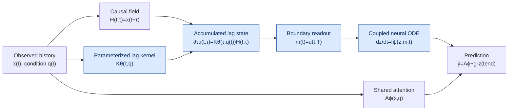

# Paper-style architecture: coupled lag PDE / latent ODE

The design follows the visual grammar of [Habiba & Pearlmutter, *Continuous Convolutional Neural Networks*](https://arxiv.org/abs/2111.00343) and [Chen et al., *Neural Ordinary Differential Equations*](https://arxiv.org/abs/1806.07366): **state evolution, continuous operators, numerical readout, and intervention location** rather than a software-component deployment diagram.

## Figure 1 — model and falsification controls

The lag direction τ and physical time t are **different**: a lag-accumulation PDE integrates causal history at each observation instant, and an ODE evolves the response across physical time. In the present discrete benchmark, the lag PDE is evaluated by cumulative quadrature; the ODE uses exponential leaky-state time stepping. **Do not advertise this as an adaptive-solver Neural ODE**. Irregular time grids and solver-tolerance/NFE experiments belong to the next study.

## Equations

For a causal observation stream x(t), condition q(t), history lag τ≥0 and terminal lag horizon T,

\[
\partial_\tau u_\theta(t,\tau)
= K_\theta(\tau,q(t))x(t-\tau),\quad
u_\theta(t,0)=0,\quad
m_\theta(t)=u_\theta(t,T).
\]

The leaky downstream state evolves as

\[
\dot z(t)=-\lambda z(t)+\lambda \tanh(\gamma m_\theta(t)),\qquad
\hat y=\mathrm{Attention}_\phi(x,q)+g z(t_\mathrm{end}).
\]

For a shared repair edit a, **the same** updated kernel K_{θ,a} is evaluated on *both* domains:

\[
a^* = \underset{a\in{\cal A}_B}{\arg\min}
\,\mathcal{L}^{\mathrm{val}}_{\mathrm{shift}}(\theta,a)
\quad\textrm{subject to}\quad
\mathcal{L}^{\mathrm{val}}_{\mathrm{source}}(\theta,a)
\le (1+\epsilon_r)\mathcal{L}^{\mathrm{val}}_{\mathrm{source}}(\theta,0)+\epsilon_a.
\]

No domain indicator enters the model forward pass. The validation constraint **does not guarantee** unseen-test preservation.

## Figure-panel design

- **(A) Architecture/continuous-time formulation:** observation stream → causal lag kernel → lag-accumulation PDE → ODE latent trajectory; attention as a separate shared readout.
- **(B) What the mechanism can and cannot represent:** overlay true generating kernels on normalized lag, with separate q trajectories for unimodal chirp, bimodal, boxcar, damped oscillator, switching and feedback-dynamics families. The teacher must not be confused with a learned kernel.
- **(C) Repair geometry:** matched budgets 1,5,18,36,56; display recovery-versus-preservation scatter/paired distribution. The proposed CCNN is distinguished by linestyle/hatching, **not** a claim of superiority.
- **(D) Continuous dynamics diagnostic (next phase):** compare evolved z(t) to held-out continuous-time targets, with solver error vs number of function evaluations (NFE) and irregular observation timestamps. This is an explicitly **future** experiment, not a capability shown by the current discrete benchmark.

All publication plots should be vector PDF/SVG plus PNG, independent-seed markers, equal axes where comparisons are made, captions naming the source/test population, and unambiguous ‘illustrative’ labels until replicated.

## Crucial separation

The **architecture experiment** compares trained CCNN with trained attention-only and dynamic FIR networks, recording model size/compute. The **repair experiment** applies different edits to the **same frozen CCNN**; this eliminates a major confound from comparing a CCNN repair to a separately pretrained unstructured network.

References: [CCNN 2021](https://arxiv.org/abs/2111.00343), [Neural ODE 2018](https://arxiv.org/abs/1806.07366).
