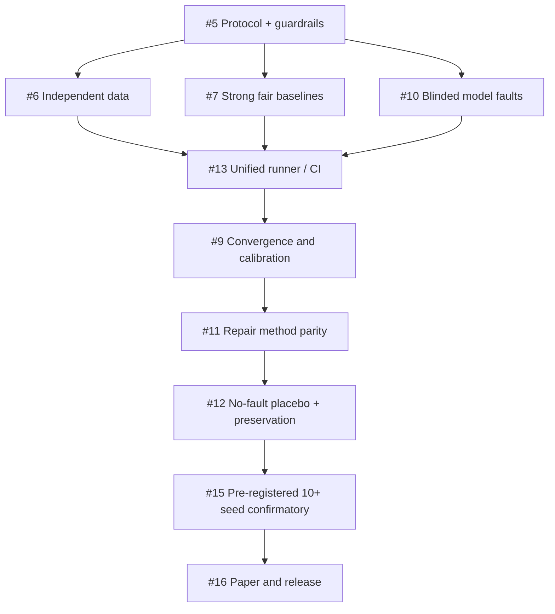

# CCNN scientific acceptance verification plan
**Status:** ready for implementation; no scientific verification from this document alone.

**Governing goals:** RQ1-M (incremental memory complementarity for attention), RQ6-M (mechanism-specific, non-regressive model-weight fault correction). Do not claim numerical integration superiority. See [charter](../../notebooks/archive/RESEARCH_QUESTIONS_CCNN_ATTENTION_WEIGHT_REPAIR.md), [mechanism-isolation protocol](../../papers/CCNN_Mechanism_Isolation_Experimental_Protocol.md), [tracker](https://github.com/mansura-habiba/ode_nn/issues/4).

## Separate what the tests establish

| Verification tier | What it proves | What it does **not** prove |
|---|---|---|
| T0, unit/invariant test | Code contracts, deterministic replay, no obvious leakage | Hypothesis advantage |
| T1, controlled integration | Modules share task, splits, inputs; oracle hidden | Convergence/fairness |
| T2, calibrated pilot | Model can learn, fault is detectable, editing objective identifiable | General-superiority claim |
| T3, preregistered confirmatory | Repeatable effect vs strongest matched competitor with paired uncertainty | Transfer to all real-world domains |
| T4, independent replication | New seeds/data/code-path withstand evaluator review | Universal CCNN superiority |

T0 is complete for each new PR branch (#17–#20, ten passing tests apiece), but **none of the four issues is yet fully verified**.

## Workstream verification gates, in executable order

### V1 — Issue #5, protocol PR #17: real preregistration
1. Run `python -m unittest discover -v -s benchmarks/ccnn_falsification -p 'test_*.py'` in the integrated branch.
2. Inspect every config field: define the task-specific effect threshold, actual sample counts, split seed IDs, optimizer search grids, total training/adaptation compute and stopping rule. Do not merely inherit V3's 12 epochs.
3. Add a **negative test** demonstrating that confirmatory execution fails while `registration_status=DRAFT_NOT_FROZEN`, while required baselines are absent, or when test IDs overlap training/calibration.
4. Persist `protocol.yaml` hash, code SHA, dataset split manifest and signed/dated freeze decision in the run manifest. Only then set `FROZEN_PRE_RUN`.
5. Execute a tiny dry run using only *synthetic smoke splits* to check output schema. The confirmatory locked test cannot be used during configuration.

**Pass:** the confirmatory runner refuses invalid/draft configs, all baseline and data contracts are frozen, and preregistration commit precedes first confirmatory test evaluation. **Fail:** post hoc cutoff/seed/fault selection, or passing merely because fields exist.

### V2 — Issue #6, independent teachers PR #18: independence and difficulty
1. For each non-CCNN family, execute seeded generation, re-generate and compare bitwise data digest; reject overlapping sample IDs and content duplicate leakage.
2. **Structural audit:** independent teacher target functions cannot import, delegate to, or call CCNN's `kernel` or `integrate_drive`. Merely differing equations but sharing the same leaky ODE is insufficient for the *primary* RQ1 claim.
3. **Learnability audit:** train an expressive oracle/reference model and a trivial predictor (mean/persistence/linear). Require predeclared evidence of nontrivial task structure (oracle/reference beats trivial baseline), rather than cherry-picking family difficulty after observing CCNN scores.
4. Ensure each architecture receives the *same* `(x,q,t)` inputs/labels and split keys. Create delayed-event/retrieval targets whose answer depends on history, including randomized distractors.
5. Exercise known-negative families, abrupt switching and feedback at increasing lag/gap distances, with independent held-out test targets.
6. Add at least one suitable external sequence benchmark and entity/time-disjoint split before an externally generalizable claim.

**Pass:** independently generated, nontrivial, reproducible out-of-family targets, leakage-free splits, strong oracle and weak trivial controls; a separate matched-chirp calibration family **excluded** from the primary aggregate. **Fail:** any primary teacher is code/functional equivalent to CCNN by construction or trivially solvable.

### V3 — Issue #7, MLP-FIR PR #19: strong and fair baseline
1. Integrate `QueryMLPFIR` into the *same* runner and inputs as CCNN. Verify chronological lag causality by perturbing future observations and checking earlier history outputs.
2. For each independent teacher run two regimes: **frozen shared attention checkpoint** and **independently joint-trained architectures**. Never compare frozen CCNN with jointly tuned FIR.
3. Parameter sweep FIR hidden width/layers to construct comparable *added trainable-parameter* bands to CCNN and one stronger flexible band.
4. Search learning rates, optimizer and early stopping under the **same validation-trial policy** for all models. Train until validation plateaus or a documented equal FLOP ceiling; report underfitting and failure to converge.
5. Record trainable/total parameters, FLOPs or rigorously labeled approximation, training time, inference latency, batch size, hardware and per-seed learning curves.
6. Include attention-only, static FIR, affine FIR, nonlinear FIR, SSM and generic Neural ODE baselines when making the full RQ1 claim.

**Pass:** same-split multi-seed test MSE/recall and accuracy–compute Pareto against the **strongest** tuned alternative, with a documented matched-resource comparison and reproducible training curves. **Fail:** equal epochs declared fair, missing stronger competitor, or CCNN claimed superior on matched chirp alone.

### V4 — Issue #10, fault injector PR #20: truly blinded, mechanism-specific correction
1. Train and freeze `theta_clean` from train/validation only. Serialize seed, model hash and optimizer state. Use **calibration**, not locked test, for fault strength.
2. Inject a fault into a copy of model weights; assert the clean, faulted and repaired networks are evaluated against the **same labels for exactly the same inputs**. Keep source and affected cohorts identifiable by *observable covariates*, never a domain gate.
3. Run separate evaluator and repair processes or containers so fault metadata and `theta_clean` are **not mounted into repair execution**. File separation alone is not a security boundary. Add a test that an editor fails to resolve the evaluator-only path.
4. Test center, q-dependent center, bandwidth, frequency, gain, **wrong-family**, mixed and equal-norm random faults. Verify exactly the declared tensors changed and clean/faulted hashes differ unless zero fault.
5. From the same clean checkpoint, run matched **zero-fault placebo** updates. Quantify `fault_headroom`, improvement after repair, placebo improvement, placebo-subtracted specificity and test source degradation; no meaningful headroom means `fault_not_detectable`.
6. Compare no edit, continued Adam, sparse Adam, tangent, Gauss–Newton, selective Kalman, low-rank, full FIR and full fine tuning under measured equivalent *updated weights, samples, steps and compute*.
7. Separate locked source/affected test populations. Gate on validation only; report rejected edits, false positives on placebo, failed source test preservation and both errors raw.

**Pass:** the fault is genuinely detectable, hidden oracle is inaccessible, labels are fixed, placebo control is run, fault-specific improvement exceeds placebo with locked test preservation and strong numerical baselines in an appropriately replicated study. **Fail:** no-fault edits explain the gain, impossible identical-input label conflict is used as primary test, or any edit relies on the oracle.

## Integration order and responsibilities

**Merge rule:** the four draft PRs may merge as tested components but the research project cannot pass the experimental gates until #9/#11/#12/#13 are complete. If CI runs but not scientific gates, keep the issue open and report *implemented/verified module only*. No new comparison results on the old V3 shifted-target design will be called mechanism-specific evidence.

## Execution environment: Google Colab + GitHub Actions

**Preferred experimental compute:** official remote Colab MCP server at `https://colaboratory.googleapis.com/mcp` (Google OAuth connection required); do not assume access or GPU entitlement until the user connects it. Google documents `list_runtime_specs`, `list_runtimes`, `create_runtime`, `create_session`, `execute_code` and session cleanup. Reuse existing eligible runtime and a dedicated session per concurrent job; avoid starting unnecessary runtimes.

**Fallback and reproducibility check:** GitHub Actions runs all CPU invariants, short pipeline tests, and independent evaluation. Use the same pinned dependency lock and container spec; for a GPU confirmatory run, Colab may compute results, but GitHub receives code, CI verification, CSV/JSON manifests, checkpoint hashes and data provenance. **Do not upload credentials or token-bearing Colab runtime metadata.**

**Run outputs:**
- `experiment_manifest.json`: code SHA, preregistration SHA, dataset family and split SHA, seed, method, hyperparameter trials, runtime device, package versions, timestamps, and compute.
- `rq1_seed_level.csv`: family, seed, arm, checkpoint hash, samples, train/validation/test MSE/recall, steps/FLOPs/seconds, and evidence state.
- `rq6_fault_level.csv`: fault_id, clean/faulted/edit hashes, detectability, placebo improvement, fault improvement, specificity excess, source test drift, accepted/rejected flags and method budget.
- `evaluation_log.json`: all aborts, missing baselines, invalid proposals, no-fault errors, and negative evidence; never fabricate missing scores.
- Figures in both SVG/PDF and PNG from the audited results, with independent validation/test labeling.

## Immediate operational checklist

- [ ] Connect official Colab MCP to ChatGPT, authenticate and verify `list_runtime_specs` / `list_runtimes`; if unavailable, use local/GitHub Actions CPU.
- [ ] Merge CI-valid component PRs #17–#20 into the research integration branch, keeping all original issues open until fully verified.
- [ ] Implement cross-module integration checks in #13 and an execution configuration for matched RQ1 experiments.
- [ ] Implement source-checkpoint adequacy (#9), fault-specific repair versus placebo (#11–#12).
- [ ] Review and freeze `protocol.yaml` before evaluating the locked confirmatory test.
- [ ] Run the confirmatory study with >=10 paired seeds, paired 95% uncertainty, and audit all negative outcomes.
