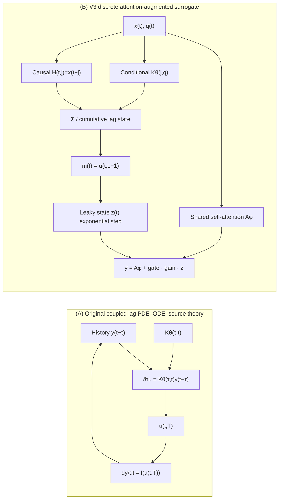
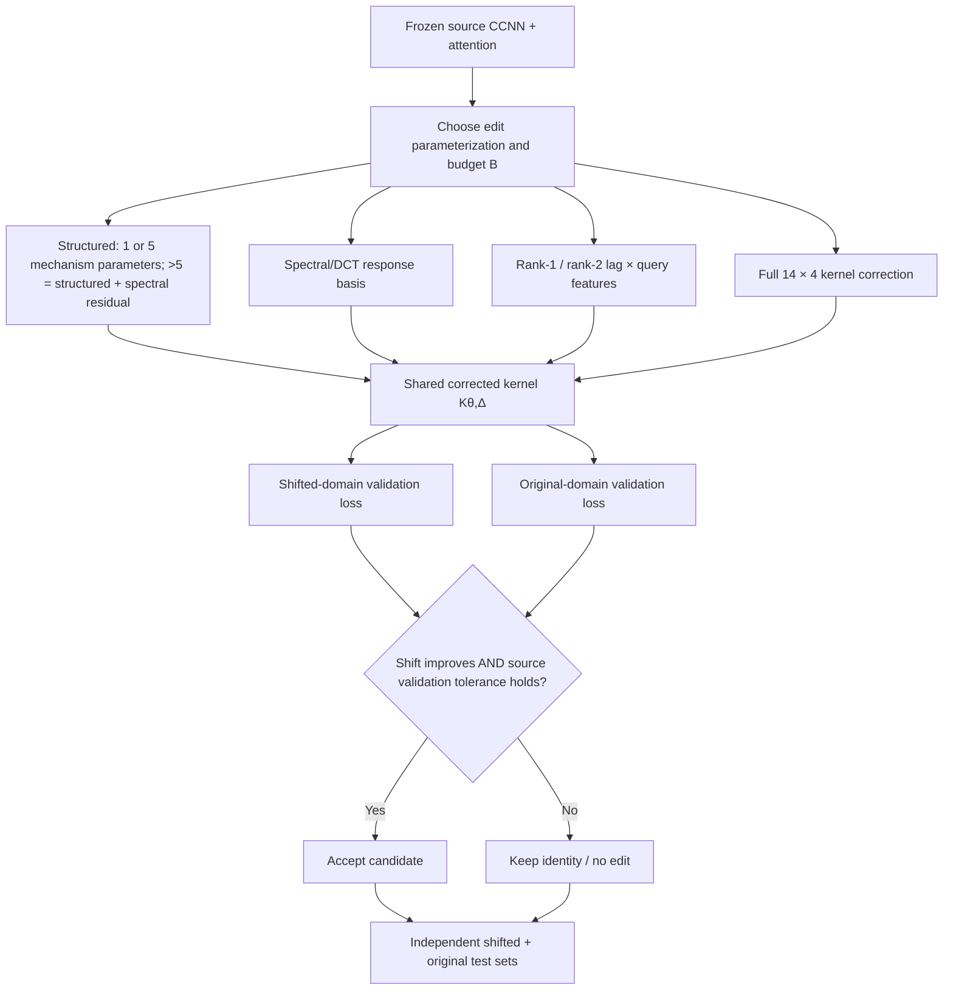

# CCNN Architecture: Coupled Lag Dynamics and Gate-Free Structure-Aware Repair

**Companion to:** [CCNN attention and weight-repair manuscript](CCNN_Attention_Structured_Weight_Repair_Paper_Draft.md)  
**Normative research charter:** [RESEARCH_QUESTIONS_CCNN_ATTENTION_WEIGHT_REPAIR.md](../notebooks/archive/RESEARCH_QUESTIONS_CCNN_ATTENTION_WEIGHT_REPAIR.md)  
**Implementation:** [V3 Colab notebook](../notebooks/CCNN_Unmatched_Kernels_Gatefree_Repair_V3_Colab.ipynb)  
**Benchmark protocol:** [V3 falsification README](../benchmarks/ccnn_falsification/README.md)  
**Status:** architecture and falsification protocol; implementation is a **discretized** lag-convolution / leaky-state model, not an adaptive continuous-time solver. Proposed studies must not be described as completed evidence.

## 1. Architectural boundary: original theory vs implemented approximation vs proposed tests

| Layer | Mathematical/computational object | Status and correct reading |
| --- | --- | --- |
| Original CCNN (Habiba & Pearlmutter, 2021) | Causal history-dependent kernel; lag-indexed PDE accumulation; dynamical ODE coupling | **Source theory**, not a spatial reaction–diffusion PDE |
| V3 data/conditioning | Observed sequence `x[b,t]`, query `q[b,t]`, fixed `N=48` and `L=14` | **Implemented**; samples lie on a regular grid, with zero prehistory |
| V3 lag field | `H[b,t,j] = x[b,t-j]` for `t>=j`; query-dependent normalized Gaussian-windowed chirp kernel | **Implemented** in `lag_history`, `kernel` |
| V3 PDE readout | `u[b,t,j] = cumsum_j(K[b,t,j]*H[b,t,j])`; drive `m[b,t]=u[b,t,L-1]` | **Implemented discrete cumulative sum**; numerical quadrature scaling/lag-axis representation must be stated when moving to physical units |
| V3 ODE response | Leaky state driven by `tanh(2m)` with exact exponential update for piecewise-constant drive | **Implemented** in `integrate_drive`; not adaptive-ODE evidence |
| V3 attention fusion | Attention over `[x,q,t,t²]` features + learned scalar times lag branch output | **Implemented** in `Attention`, `LagField`, `Model` |
| V3 repair | Frozen source model; same learned correction on source and shifted samples; no domain indicator/gate | **Implemented benchmark design**; source preservation is measured on independent test sets |
| Independent physical dynamics, irregular timestamps, loss geometry mapping | Nonmatching full dynamical systems; irregular-time history representation; Hessian/path diagnostics | **Proposed**; not established by the notebook |

## 2. Equations and state coupling

For observation time `t` and historical lag `τ∈[0,T]`, the *source-theory* dynamics are

\[
\partial_\tau u(t,\tau)=K_\theta(\tau,t)y(t-\tau),\quad
u(t,0)=0,\quad \dot y(t)=f(u(t,T)).
\]

The lag index `τ` is **not** the ODE's physical time `t`. The original theory uses a delayed trajectory; treating the lag PDE alone as a Markovized state would be incorrect. The research charter additionally proposes a separate history-transport state `h(t,τ)=y(t-τ)`, obeying `∂_t h+∂_τ h=0` with `h(t,0)=y(t)`; **V3 does not solve this transport PDE**.

The V3 attention augmentation uses an observed exogenous history rather than recursively feeding the predicted `y` into the kernel:

\[
H(t,\tau)=x(t-\tau),\quad
\partial_\tau u_\theta(t,\tau)=K_\theta(\tau,q(t))H(t,\tau),\quad
m_\theta(t)=u_\theta(t,T),
\]
\[
\dot z(t)=-\lambda z(t)+\lambda\tanh(\gamma m_\theta(t)),\quad
\hat y=A_\phi(x,q)+g\,z(t_{\rm end}).
\]

The implemented kernel is proportional to

\[
K_\theta(\tau,q)\propto
\exp\!\left[-\frac{(\tau-\mu_0-\mu_q q)^2}{2\sigma^2}\right]
\cos\!\left(2\pi(f\tau+c\tau^2)\right),
\]

and is normalized by its discrete lag-axis Euclidean norm (epsilon stabilized). Its five principal mechanism parameters are `μ₀, μ_q, logσ, f, c`; the lag branch additionally learns a gain. Implementation uses `λ=8`, `γ=2`, `Δt=1/N`, and `α=1−exp(−8/N)`, with `z_next=(1−α)z+α tanh(2m)`. These constants describe the **V3 experiment**, not required properties of all CCNNs.

### Figure A/B: theory and implemented forward pass

**Diagram interpretation.** The two subgraphs are conceptually aligned but **not mathematically identical implementations**: V3 uses fixed-grid zero-padded history, normalized discrete coefficients, cumulative sums and explicit leaky-state stepping. The `gate` on the fusion branch is an existing learned amplitude coefficient; it is **not a domain-selection gate for repair**.

## 3. Intervention surfaces and common frozen-base comparison

The defining V3 repair test is whether a **single shared weight update** can improve the shifted condition while retaining performance on the original condition. Freeze the trained attention and lag model; each candidate adapter modifies only the kernel. The same adapted kernel runs on both populations without knowing which domain a sample belongs to.

V3 defines discrete repair budgets `B ∈ {1,5,18,36,56}`:

| Budget | Structured / hybrid | Spectral basis | Low rank | Full coefficient edit |
| ---: | --- | --- | --- | --- |
| 1 | kernel center (1) | 1 coefficient | — | — |
| 5 | five kernel parameters | 5 coefficients | — | — |
| 18 | five parameters + 13 spectral residuals | 18 coefficients | rank 1 (14+4) | — |
| 36 | five parameters + 31 spectral residuals | 36 coefficients | rank 2 (28+8) | — |
| 56 | five parameters + 51 spectral residuals | 56 coefficients | — | 14×4 |

Spectral and dense corrections operate in an explicitly specified four-feature query basis `[1,q,q²,sin(πq)]`. At budgets above five, the label **structured** means *hybrid structured+spectral*, not pure five-parameter CCNN repair. Same scalar budget does not imply same attainable function changes, Jacobian conditioning, optimization geometry or FLOPs.

A repair is eligible on **validation** if shifted loss decreases and original validation loss satisfies the notebook protocol:

\[
L_{\rm source}^{val}(\theta+\Delta)
\le 1.10\,L_{\rm source}^{val}(\theta)+10^{-4}.
\]

The no-edit candidate remains available. Report both test losses and whether the independent original-domain test passes. Validation acceptance **does not entail** test preservation; incompatible source/shifted targets may impose a real Pareto tradeoff.

## 4. Mechanistic falsification and experimental controls

V3's teacher families are `matched_chirp`, `bimodal`, `boxcar`, `damped_oscillator`, `switching`, and `feedback_ode`. Only the first is matched to the five-parameter teacher form. The latter five exercise kernel mismatch; `feedback_ode` additionally stresses downstream dynamics. Most families still share the same leaky integration design, so *unmatched kernel* is not the same as an independently generated physical dynamical system.

Separate the scientific questions instead of mixing denominators:

1. **Architecture / RQ1-M:** retrain attention-only, attention+static/dynamic FIR, exponential SSM and attention+CCNN as relevant; compare independent held-out prediction, parameter counts, timing and compute. A structurally matched teacher win is a positive control, not generalized superiority.
2. **Repair / RQ6-M:** hold the **same trained CCNN** fixed across structured, spectral, rank and full-kernel adapters. Evaluate shifted recovery against original retention without a repair-time domain gate.
3. **Fault specificity:** include no-fault `shift=0`; test mismatch of edit mechanism and fault mechanism. A delay coordinate should not be presumed to correct frequency or switching defects.
4. **Next decisive tests:** independent full dynamical-system teachers, irregular physical timestamps with defined interpolation/quadrature error, strong compute-matched SSM and dynamic-convolution baselines, multiple shifts and optimizers, ≥10 paired seeds with uncertainty.
5. **Loss geometry (planned):** for identical frozen base, draw 2-D validation-loss slices using normalized edits, show source and shifted contours, identify minima, and overlay optimizer paths. Measure gradient norm, local curvature/conditioning, acceptance boundaries and basin robustness. Do not label a plotted theoretical landscape as measured data.

The current V3 notebook has a **smoke configuration** (one seed, three families) and a larger **full configuration** (ten seeds, six families); successful execution and independent confirmation must be checked from generated manifests. A plotted teacher kernel is **not a learned kernel**; figures should label source versus shifted populations, held-out versus validation, and synthetic/illustrative versus measured.

## 5. Figure C/D and publication requirements

The supplied four-panel architecture illustration is an **explanatory design**, not an empirical results figure. Panel A sketches original theory, B the discretized implemented surrogate, C the shared-weight repair choices, and D the decisive future tests (unmatched kernels, capacity matching and measured loss geometry). Its miniature loss surface and kernel shapes must be captioned **schematic unless regenerated from actual notebook data**. Avoid interpreting its arrows as measured superiority.

A publication-ready evaluation should include: held-out per-seed metrics, paired uncertainty, measured compute and training latency, repair-validation acceptance rates, test-time preservation rates, change sizes (parameter and function space), optimization diagnostics, and explicit negative results. Figures should link to their exact generating configuration/manifest. Do not conflate the earlier V2 **domain-gated** repair results with V3's **shared ungated** intervention.

## 6. Traceability and claims boundary

- **Original mathematics:** [Habiba & Pearlmutter (2021)](https://arxiv.org/abs/2111.00343), as interpreted in the [research charter](../notebooks/archive/RESEARCH_QUESTIONS_CCNN_ATTENTION_WEIGHT_REPAIR.md).
- **V3 implementation and experimental status:** [Colab](../notebooks/CCNN_Unmatched_Kernels_Gatefree_Repair_V3_Colab.ipynb), [benchmark protocol](../benchmarks/ccnn_falsification/README.md), [existing benchmark architecture](../benchmarks/ccnn_falsification/ARCHITECTURE.md).
- **Earlier pilot results:** [manuscript](CCNN_Attention_Structured_Weight_Repair_Paper_Draft.md) Sections 4–6; those numbers are preliminary **V2**, not automatically reproduced by V3.
- **Not established:** general CCNN advantage, exact continuous-time solver superiority, an ability to preserve both domains without tradeoffs, or successful LLM weight reasoning.

**Architectural hypothesis:** lag-kernel structure offers an interpretable, low-dimensional edit surface that may help attention and localize certain failures. **Empirical test:** determine when this wins, ties or loses against expressive, cost-matched alternatives under genuinely independent dynamics and independent source-retention tests.
