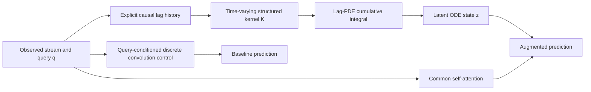
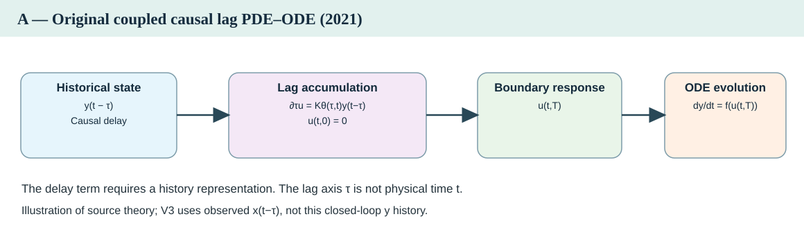
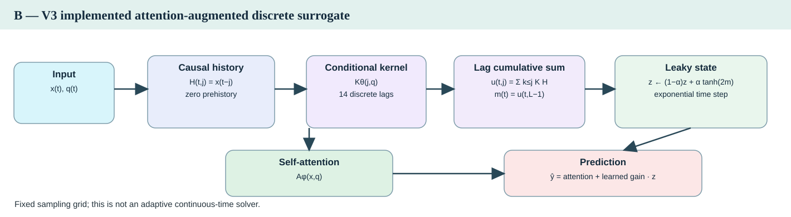
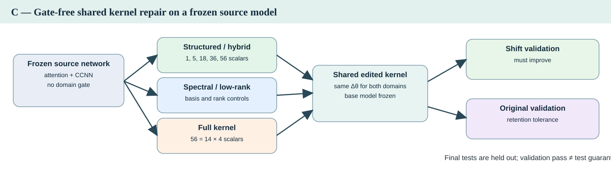
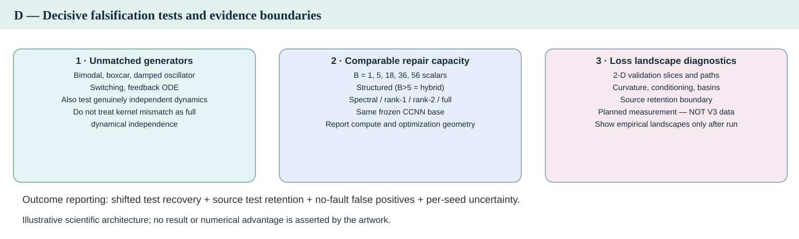

# Structure-Aware Continuous Convolution for Attention Augmentation and Verified Neural Weight Repair

**Research manuscript — preliminary technical report, 15 November 2026**  
**Research identities:** RQ1-M (attention augmentation), RQ6-M (mechanism-specific repair), RQ7 (LLM-proposed weight edits, not yet evaluated)  
**Evidence level:** controlled synthetic pilot, two independent model seeds; no real-world claims

## Abstract

Attention mechanisms learn content-dependent interactions between observations, but they do not by themselves enforce a compact, continuously parameterized causal response over historical lags. Coupled Continuous Convolutional Neural Networks (CCNNs), in the formulation of Habiba and Pearlmutter (2021), represent an accumulated lag convolution through a partial differential equation (PDE), whose boundary value supplies an ordinary differential equation (ODE). We ask whether this mathematical structure contributes something useful to attention and whether its interpretable kernel parameters enable more precise, verifiable repairs than less structured neural-filter parameters. To investigate these questions independently, we construct a synthetic sequence-forecasting task driven by a time-varying Gaussian-windowed chirp filter. We compare attention with static convolution, query-conditioned discrete convolution, exponential-state memory, and a compact lag-kernel/PDE–ODE branch. We then inject a delay shift and evaluate one-parameter Jacobian, Adam, and random repairs against a one-coordinate unstructured filter repair. In a preliminary two-seed experiment, attention augmented with the structured lag kernel obtains a mean held-out mean-squared error (MSE) of **6.35 × 10⁻⁶**, compared with **8.23 × 10⁻⁴** for the strongest query-conditioned discrete convolution control. Sparse Adam repair reduces shifted-domain error from approximately **1.00 × 10⁻²** to **8.99 × 10⁻⁶**. The experiment deliberately gives the structured model a matched generative family; consequently the observations establish controlled feasibility, not general architectural superiority. Original-domain preservation is guaranteed by a domain-gated intervention rather than discovered by the optimizer. We outline nonmatching-generator, strong-adapter, computational-budget and open-weight language-model controls required before advancing the claims.

## 1. Introduction

The invariant research question is:

> **Can the mathematical structure of coupled continuous convolution make attention more effective and neural-network weight repairs more precise than less structured alternatives?**

The question contains two **independent** claims. First, an explicit response over time lag might complement content-addressed attention. Second, the semantic structure of a learned convolutional kernel (delay, bandwidth, chirp rate) might permit controlled local repairs after shifts in the data-generating mechanism. Neither claim entails the other. A conventional time-aware convolution or state-space model may match or exceed the proposed augmented attention mechanism, and a numerical optimizer may outperform a language-model weight proposer.

Our previous exploratory diffusion toys investigated a spatial operator, which is **not** the defining historical-lag convolution from the original CCNN paper [1]. The present investigation deliberately restores that distinction and does not rely on spatial diffusion or resolution-transfer outcomes to justify attention augmentation.

## 2. Source mechanism and adaptation

The original paper [1, Eqs. (2)–(6)] proposes a causal, time-varying convolution of the historical trajectory:

\[
\dot y(t)=f\!\left(\int_0^T K_\theta(\tau,t)y(t-\tau)\,d\tau\right).
\]

The accumulated lag-PDE state satisfies

\[
\frac{\partial u(t,\tau)}{\partial \tau}=K_\theta(\tau,t)y(t-\tau),\qquad u(t,0)=0,
\]

and supplies the ODE through \(\dot y(t)=f(u(t,T))\). The delay term in the PDE's right-hand side is a genuine implementation issue discussed in the paper; writing the system in terms of \(u\) does not by itself yield an autonomous Markov state without representing the history. The present toy supplies the observed history explicitly.

### 2.1 Proposed attention augmentation

Let \(x_i=x(t_i)\) be a scalar observed signal and \(q(t_i)\) an external, time-varying query. The proposal constructs a historical kernel response:

\[
m_\theta(t)=\int_0^T K_\theta(\tau,q(t))x(t-\tau)\,d\tau,
\]

which drives a leaky latent ODE \(\dot z=-\lambda z+\lambda\tanh(2m_\theta(t))\). A common self-attention backbone emits \(a_\psi(x,q)\); the augmented forecast is \(\hat y=a_\psi(x,q)+g z(t_{\mathrm{final}})\). We use cumulative lag quadrature and exact exponential stepping for piecewise-constant forcing in the pilot. These are discrete numerical approximations, not a complete continuous PDE solver implementation.

The kernel is a normalized Gaussian-windowed chirp with conditional center:

\[
K_\theta(\tau,q)\propto\exp\left(-\frac{(\tau-\mu_0-\mu_q q)^2}{2\sigma^2}\right)
\cos(2\pi[f_0\tau+c\tau^2]).
\]

The five principal kernel parameters are center, query-dependent displacement, bandwidth, carrier frequency, and chirp rate. In contrast, the unstructured dynamic-filter control learns 14 free kernel coefficients plus 14 query-response coefficients. Its extra freedom is a serious baseline, and it should not be dismissed as an ordinary static CNN.

### 2.2 Method diagram

The **novelty under examination** is not the existence of a continuous integral, an ODE, or a convolution alone. It is the *incremental utility* of the original lag-structured mechanism when used alongside attention, and the identifiability of its parameter repair surface.

## 2.3 Architecture and V3 falsification alignment

The detailed, versioned architecture specification is maintained in **[CCNN Architecture: Coupled Lag Dynamics and Gate-Free Structure-Aware Repair](CCNN_ARCHITECTURE.md)**. It relates the original Habiba–Pearlmutter lag PDE–ODE formulation to the implemented V3 discrete model and the planned mechanism-specific evaluations.

In the original source theory, the lag field accumulates delayed history and its boundary drives dynamical evolution. **V3 approximates this** with an explicitly constructed, zero-padded causal history `H(t,j)=x(t-j)`, a normalized query-conditioned Gaussian-chirp kernel, discrete cumulative lag sums, and exponential stepping of a leaky latent state. The output adds a learned-scale lag response to a common self-attention prediction; this is an attention augmentation experiment, not a claim to implement an adaptive continuous-time PDE/ODE solver.

For repair, V3 **freezes the source attention–CCNN model** and tests shared, ungated kernel edits on *both* source and shifted populations. Its budgets `1, 5, 18, 36, 56` compare structured/hybrid, spectral, rank-limited and full lag-by-query correction surfaces, with validation-only edit selection and independent test-domain retention. Above five adjustable scalars, “structured” denotes **structured plus spectral residual** rather than a purely five-parameter kernel intervention. A source-validation tolerance is not a guarantee of source-test preservation.

The supplied four-panel illustration maps to **(A)** original theory, **(B)** implemented V3 surrogate, **(C)** proposed shared-weight repair comparisons, and **(D)** decisive planned falsification tests. Unmatched kernel families and independent-domain evaluation are in V3; loss-landscape trajectories are a **planned measurement**, not an observed empirical figure. See the companion architecture for the equations, Mermaid diagrams, explicit repair-budget table and evidence boundary.

## 2.4 Four-panel architecture figures: validation and interpretation

The supplied composite figure has been separated into panels A–D for independent study. The repository embeds **validated, redrawn SVG versions** below (rather than presenting the original schematic as quantitative evidence). The original user-provided raster was cropped separately; the redrawn SVGs incorporate clarified notation and scientific status labels.

### Figure A — Original coupled lag PDE–ODE (source theory)

**Interpretation.** The historical trajectory enters a time-varying causal kernel. Integrating along lag `τ` gives the cumulative field `u(t,τ)`; its terminal lag response `u(t,T)` drives temporal ODE evolution. This is a history-delay formulation rather than a spatial reaction–diffusion model.

**Validation of supplied panel A:** the original mathematical boundary condition should be **`u(t,0)=0`**, not an interchange of `t` and `τ` such as `u(0,t)=0`. The partial derivative is in the **lag coordinate `τ`**, while the ODE evolves in physical time `t`. The closed delayed-feedback formulation depends on access to `y(t−τ)`; V3 substitutes observed `x` history and does not implement a Markovized history-transport PDE. Kernel curves in the supplied artwork are illustrative.

### Figure B — Implemented V3 attention-augmented surrogate

**Interpretation.** V3 constructs `H(t,j)=x(t−j)` with zero-padding, calculates a query-conditioned, 14-lag normalized kernel, accumulates the elementwise product by `torch.cumsum`, and uses the final lag index to drive a leaky latent state. The attention path consumes `x,q,t,t²`. The prediction adds attention to a learned-amplitude branch response.

**Validation of supplied panel B:** the cumulative sum is a **fixed-grid discretization**, not proof of a continuous-time solver or irregular-timestamp support. The actual branch includes a learnable kernel-response gain **and** a learned fusion coefficient. The update uses `α=1−exp(−8/N)` and `tanh(2m)` in V3; the generic drawing's `φ` and `g` notation abstracts this. A lag quadrature in physical units would require explicit `Δτ` treatment.

### Figure C — Shared ungated repair

**Interpretation.** Repair compares parameterized edit surfaces acting on **one identical frozen CCNN**. The corrected kernel is shared across original and shifted populations. Candidates are selected using shifted validation improvement **and** source validation retention; held-out source and shifted tests are evaluated independently.

**Validation of supplied panel C:** the pre/post kernel silhouettes are **schematic**, not necessarily trained or recovered kernels. V3 permits structured, spectral, low-rank and full lag-by-query corrections. The pure mechanism edit has at most five kernel parameters; for budgets above five the so-called structured method is actually **structured + spectral residual**. Equal counts of trainable scalars alone do not establish equal functional repair capacity. There is **no repair-domain gate** (the model's existing scalar attention-fusion multiplier is unrelated).

### Figure D — Decisive controls and planned geometry study

**Interpretation.** The first test asks whether the structured inductive bias helps on *unmatched* kernels. The second holds the frozen model and explicit trainable-parameter budget fixed across adapter families. The third would inspect validation-loss surfaces, curvature and optimization paths, alongside source-preservation boundaries, to understand whether an apparent repair advantage reflects favorable geometry or capacity.

**Validation of supplied panel D:** its multipeak, oscillator, long-range kernel sketches and colored 3-D landscape are **conceptual**, not measurements from V3. V3 currently includes bimodal, boxcar, damped-oscillator, switching and feedback-ODE teachers but **not a dedicated fractional/power-law teacher**. The loss-surface/path diagnostic is **planned** and cannot be presented as observed results. Matching scalar count does not automatically match time, FLOPs, tangent-space expressivity or optimizer conditioning.

**Figure caption / provenance:** Figures A–D are publication-style *architecture schematics*, reconstructed and corrected from the user-supplied composite. They document source theory, concrete V3 code and registered next tests. None plots experimental superiority; quantitative illustrations must be replaced with measured, manifest-linked results prior to publication.

## 3. Research hypotheses and prior-defined evaluation

- **H-A: attention augmentation.** A structured lag kernel may outperform attention alone and comparably sized static/dynamic convolution and exponential-memory controls on a changing-delay matched-filter task.
- **H-B: structured precision of weight repair.** After a known delay shift, a one-scalar edit to the lag-kernel center may outperform a one-scalar edit to an arbitrary discrete-filter coordinate.
- **H-C: mechanism specificity.** A delay edit should not fully repair an unrelated chirp-frequency change; no edit should be needed if the generating system is unchanged.
- **H-D: reasoning-driven WSP.** One of three open-weight instruction models might propose a useful bounded edit, but there is no presumption that it improves on Jacobian/Adam optimization.

**Primary endpoints:** held-out test MSE for H-A and H-B, independent validation acceptance for H-B, and negative-control false-acceptance rate for H-C. Secondary endpoints include model parameter counts, training time, and response to changed query dynamics. Seed-level evidence should be retained; two seeds are too few for confirmatory statistical tests.

## 4. Experimental design

### 4.1 Representative toy data

The toy uses 48 observed time points, 14 historical lag positions, additive noise, randomized chirp-like motifs, and a time-varying query affecting the center of the matching kernel. The ground-truth target is an accumulated kernel response propagated through a leaky ODE. Each seed trains on 480 examples for 30 epochs and evaluates separate validation/test sequences. A second test split changes the range of temporal-query variation while preserving the kernel family.

The generating process was intentionally selected from the structured model family to isolate a possible inductive-bias effect; it is **not** an independent test of universal operator learning.

### 4.2 Attention and temporal baselines

The five systems use a shared small attention architecture. The control modules are: none (attention only), a static 14-lag filter, a query-conditioned 14-lag filter, a small exponential-memory SSM, and the proposed lag-kernel/PDE–ODE branch. They are not exactly parameter or compute matched; the training and inference budgets and parameter counts must be taken into account in later confirmatory studies.

### 4.3 Controlled repair

For a shifted operating condition, the target kernel center is displaced by 0.12 normalized lag units. **The base network is frozen.** A candidate scalar \(\delta\in[-0.3,0.3]\) is applied to the structured delay for shifted-domain examples only. For the less structured filter, the candidate edits one selected discrete filter coordinate. Both interventions use one scalar, though their induced function changes are not equally expressive. Jacobian repair uses local sensitivity, Adam optimizes one scalar, and random search proposes a bounded set of candidates. A candidate is accepted if it improves validation loss by at least 0.5% versus no edit.

Source-domain predictions never receive the new-domain adapter, so old-domain behavior is *unchanged by construction*. This is a useful safety design but **not** an empirical demonstration that unconstrained shared-weight changes can avoid regression. The same-domain validation decision and final test are kept separate.

## 5. Preliminary experimental outcomes (two seeds)

### 5.1 Predictive performance

| Model | Held-out MSE ↓ |
|---|---:|
| Attention | 0.0137637 |
| Attention + static filter | 0.00305383 |
| Attention + exponential SSM | 0.0135316 |
| Attention + query-conditioned discrete filter | 0.000822747 |
| **Attention + structured lag CCNN** | **0.0000063463** |

These means summarize two independent seeds (11 and 23). The structured lag kernel accurately matches the teacher family, while the dynamic unstructured filter is itself much stronger than attention alone. The relative advantage may shrink under nonmatching generators, longer sequences, adaptive numerical solvers, stronger state-space controls, or tuned capacity.

### 5.2 Mechanism-specific repair

| Repair arm | Shifted-domain test MSE ↓ |
|---|---:|
| Structured lag kernel — Jacobian edit | 0.000511476 |
| **Structured lag kernel — Adam edit** | **0.0000089911** |
| Structured lag kernel — random edit | 0.00293512 |
| Query-conditioned filter — Adam, one coordinate | 0.00870626 |
| Query-conditioned filter — Jacobian, one coordinate | 0.00867422 |

Before repair, the shifted structured model's test MSE is approximately 0.0100. Adam identifies a delay edit close to the data-generating displacement. The stronger result must be interpreted as **a favorable, low-dimensional fault/repair alignment**: one center shift changes many lag coefficients coherently, whereas the control's single-coordinate edit cannot shift its full response. A fairer next comparison will allow the dynamic-filter baseline to edit a full tangent direction or a trainable low-rank basis over lag coefficients.

### 5.3 Negative controls

Both seeds reject edits when no fault exists in the tested validation set. When the fault changes the chirp frequency rather than delay, optimizing delay alone reduces but does not eliminate the error (approximately 0.0227→0.0154 and 0.0268→0.0165 across the two seeds). This is expected from the restricted mechanism class; it is not a universal fault-diagnosis guarantee.

### 5.4 WSP outcome status

**Not evaluated.** The notebook offers an optional three-model Hugging Face inference arm using two Qwen sizes and SmolLM2. Without executed proposals, their generation time, validity rate, accuracy, and benefit over Adam/Jacobian methods are unknown. The LLM sees aggregate diagnostic statistics, not reference shift values; even a successful scalar proposal would not establish general weight-space reasoning.

## 5.5 Publication visualizations and figure provenance

The accompanying [executable publication notebook](../notebooks/CCNN_Lag_Kernel_Attention_Repair_Publication_V2_Colab.ipynb) generates five figure sets. All are exported as SVG/PDF and high-resolution PNG with a JSON figure manifest; the paper should reuse the vector exports rather than raster screenshots.

- **Figure 1 — Proposed mechanism and verification.** Panel A separates attention from the structured lag integral and coupled ODE. Panel B shows the restricted edit and independent acceptance gate. The heavy outlines identify the *proposed mechanism*; they do not imply a positive empirical result.
- **Figure 2 — Causal memory field.** A representative teacher signal and query produce a signed time-varying lag kernel, a discrete cumulative lag-integral state, and an evolving ODE state. This is a mathematical illustration, not learned model evidence.
- **Figure 3 — Architecture comparison with cost.** Held-out and shifted-query MSE are displayed with every available per-seed value, and cost is shown against prediction error. With two seeds, confidence intervals would not support confirmatory inference.
- **Figure 4 — Mechanism-specific weight edits.** A representative learned/shifted/repaired kernel, the validation loss as a function of edit magnitude, and the held-out error from Jacobian, Adam and random edits. Kernel shapes are not identifiable from scalar-output loss alone; the example is diagnostic rather than evidence of exact physical parameter recovery.
- **Figure 5 — Negative controls and model capacity.** No-defect edit acceptance, frequency-fault failure of delay-only repair, and unmatched parameter counts prevent a misleading positive-only narrative.

**Scientific visualization policy.** Never mix an illustrative teacher sample with held-out experimental estimates without labelling the distinction. The proposal is highlighted by a consistent outline or hatch, but bars and axes are not rescaled to manufacture a win. Exported data and the scripts generating them remain associated with the manuscript. This pilot is not a journal-grade benchmark: confirmation requires many seeds, strong alternative models, out-of-family sources, matched budgets, and transparent uncertainty estimates.

## 6. Discussion: a measured boundary, not an assumed repair advantage

The original CCNN formulation provides a compact parameterized historical-lag response that can be used alongside attention. The earlier matched-teacher pilot showed that a model containing a kernel family deliberately aligned with its generator attained low error. **This demonstrates representational compatibility in a favorable setting, not a general improvement in attention and not a verified repair advantage.** Its domain-gated interventions automatically protected the source domain, so they cannot establish ungated, non-regressive editing.

The [V3 exploratory execution ledger](CCNN_V3_Execution_Evidence_Ledger.md) records **three seeds, six teacher families, twelve training epochs, and twenty repair steps**. CCNN achieved held-out MSE **0.000629** for matched chirp, versus **0.006847** for dynamic FIR. But on **all five unmatched teacher families**, dynamic FIR achieved lower MSE than CCNN. This is not a confirmatory generalization conclusion: source training adequacy, capacity/compute matching and generator independence were insufficient. It does, however, identify a **testable boundary**: a compact lag-structured prior may be advantageous near its functional family but unduly restrictive for other kinds of temporal memory.

The V3 repair results raise a sharper failure: **87 of 90 zero-fault trials accepted weight updates**. A changed output after an edit could therefore be ordinary additional optimization rather than fault-specific correction. The prior statement that these experiments demonstrated structure-aware repair feasibility is withdrawn. The existing evidence does **not** isolate that mechanism.

### 6.1 Experiments that close the gap

Use **one published independent benchmark**, the pinned Zoology multi-query associative recall (MQAR) generator, for attention, memory and repair. All algorithms must load **byte-identical** training, validation, calibration and locked-test examples (not merely independently generated datasets from the same distribution). The original Zoology trainer reports test configurations during training; the adapted comparison must reserve a genuine locked test not used for tuning, checkpoint selection or fault magnitude.

| Stage | Measurement required | Competing explanation tested |
|---|---|---|
| **Shared-data contract** | Frozen tensor hashes, query masks and target labels shared across CCNN, FIR and official attention/Hyena/Based/Mamba | Dataset mismatch or test-driven model selection |
| **Attention augmentation** | Adequate validation-selected training; held-out query recall and evidence selection; CCNN-branch ablation; parameter/compute accounting | Extra capacity, poor tuning of baselines, irrelevant memory branch |
| **Model-weight repair** | Calibration-detectable weight faults with unchanged labels; blind edits; structured/tangent/full FIR/Adam alternatives; zero-fault placebo and locked-test source retention | Continued training, oracle fault knowledge, hard domain gating |
| **Interpretation and replication** | Paired multi-seed uncertainty; results stratified by lag regime and fault class; failure modes and compute | Favorable teacher, isolated lucky seed, mismatched functional damage |

These stages are linked: **a memory branch that does not contribute to a sufficiently trained checkpoint cannot support a meaningful repair test**. If the fault is not detectable under calibration, repair outcomes must be labeled as such rather than assigned an invented recovery. A repair that regresses untouched capabilities fails the preservation criterion even when the affected-domain loss improves.

### 6.2 Boundary-oriented scientific outcomes

The completed paper will report the **observed condition → measured effect → mechanism interpretation → exception → next experiment**, instead of ending at a binary supported/rejected statement:

1. **Both retrieval and repair improve:** evidence for a shared structural advantage in the measured lag-memory and fault regime; investigate transfer boundaries.
2. **Retrieval improves, repair does not:** attention augmentation benefits from a temporal prior but its weight coordinates are not uniquely repairable; investigate local tangent geometry or numerical conditioning.
3. **Repair improves, retrieval does not:** the contribution may be localized edit geometry rather than general memory superiority; study preservation-constrained adapters.
4. **Only matched regimes benefit:** quantify how kernel mismatch and dynamic lag variation eliminate the effect; consider adaptive/mixed lag kernels only if the failure indicates a specific limitation.
5. **Neither benefit survives fair comparison:** report the negative finding and its mechanism. Do not redesign the teacher to make the proposed model win.

The five cases are **a predeclared interpretation framework, not measured final outcomes**. Their frequency, uncertainty and cost will be determined from the frozen benchmark. Existing V3 findings remain separate exploratory evidence; they are not copied into Zoology outcome tables.

### 6.3 Limits of the current implementation

The current notebook tests a **new direct attention-logit coupling** built from the original CCNN lag integral and leaky state. It does not reproduce the attention architecture of the 2021 paper, which did not study this coupling. The independent unstructured comparator must have access to the same logit-modification pathway. The official Zoology controls must share frozen data and an untouched test; their implementation and compute budgets must be audited before comparative claims. A small Colab run is an exploratory experiment, not an exact multi-GPU reproduction of the ICLR 2024 figure.

## 7. Conclusion and future research

The exploratory matched-generator result supports pursuing a **narrower, mechanism-based investigation** of structured historical convolution as an attention complement and repair interface. It does not authorize a broad claim that CCNN exceeds Transformers or SSMs. Future work has a clear order: (1) compare on nonmatching and mixed-mechanism generators with longer histories and missing/irregular timestamps; (2) allow flexible but compute-matched dynamic-kernel/SSM/Hyena-like competitors; (3) evaluate automatic fault localization and multi-coordinate repair under a genuine original-domain non-regression constraint; (4) run a three-model Hugging Face WSP audit with diagnostic corruption and weight-coordinate permutation controls; (5) repeat with ≥10 independent seeds and rigorous timing. A paper-level conclusion will depend on those tests, including outcomes that contradict the proposed advantage.

## References

1. M. Habiba and B. A. Pearlmutter. *Continuous Convolutional Neural Networks: Coupled Neural PDE and ODE*. arXiv:2111.00343 (2021). https://arxiv.org/abs/2111.00343
2. A. Vaswani et al. *Attention Is All You Need*. NeurIPS (2017). https://arxiv.org/abs/1706.03762
3. M. Poli et al. *Hyena Hierarchy: Towards Larger Convolutional Language Models*. ICML (2023). https://proceedings.mlr.press/v202/poli23a.html
4. A. Gu and T. Dao. *Mamba: Linear-Time Sequence Modeling with Selective State Spaces*. arXiv:2312.00752 (2023). https://arxiv.org/abs/2312.00752
5. R. Takehi, J. Teoh, A. Zhang, O. Khattab. *Sparks of Weight-Space Programming*. MIT CSAIL research demonstration (2026). https://rikiyat.github.io/blog/weight-space-programming/
6. N. S. Ahmed. *Can an LLM Actually Reason and Program about Neural Network's Weights?* arXiv:2611.08070 (2026). https://arxiv.org/abs/2611.08070